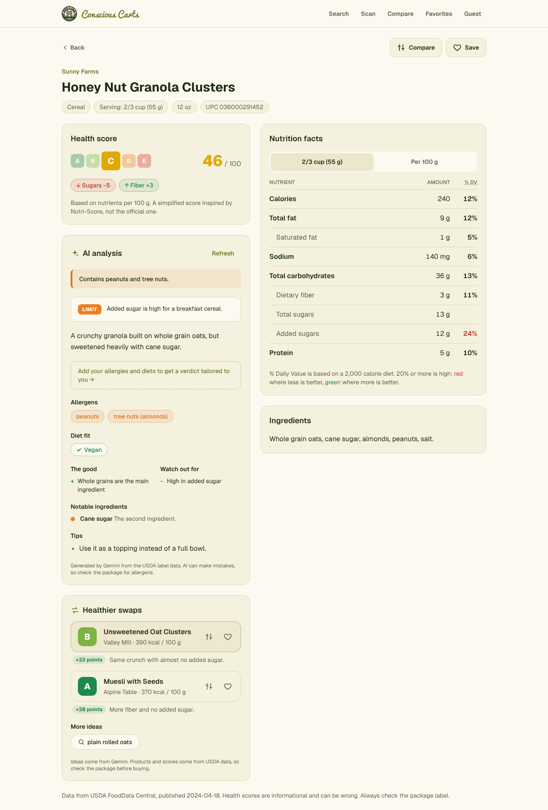
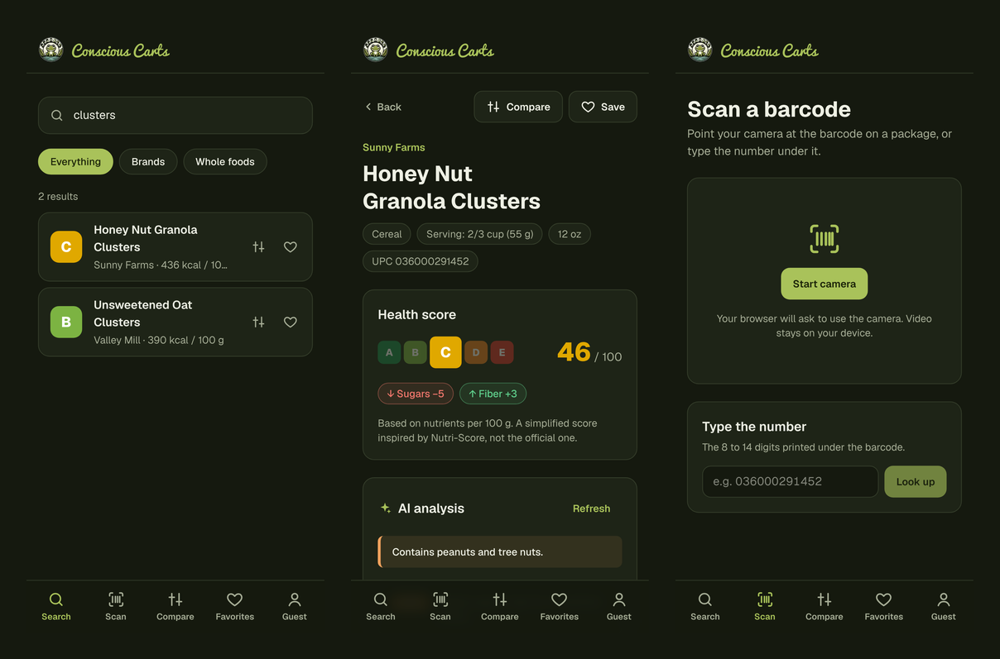
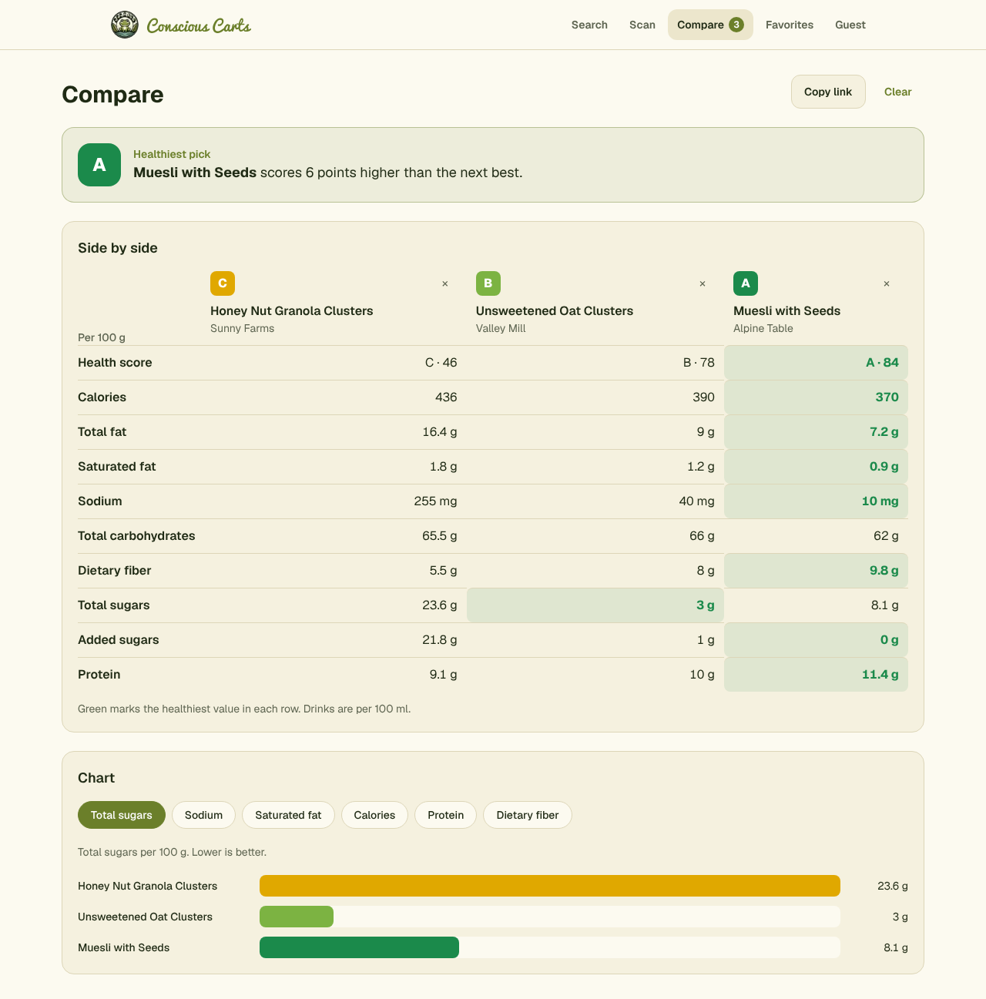

# Conscious Carts

[](https://github.com/2SikNinja/Conscious-Carts/actions/workflows/ci.yml)

Search, scan, and compare grocery products, then get an AI nutrition analysis tailored to your allergies, diets, and goals.

**Live site: [carts.ppeternnguyen.com](https://carts.ppeternnguyen.com)**



<p align="center">
  
</p>



<sub>Screenshots use sample products.</sub>

## Features

- **Search** branded and whole foods from the USDA database, with filters and infinite scroll
- **Barcode scanning** with a phone or laptop camera, plus manual entry with check-digit validation
- **Health score** from A to E on every product, computed from its nutrients, with the factors that moved it
- **AI analysis** with a verdict, allergens, diet fit, notable ingredients, and tips
- **Dietary profile** of allergies, diets, goals, and ingredients to avoid, applied to every analysis
- **Healthier swaps**: AI ideas grounded in real products that score higher and pass your allergen checks
- **Compare** up to 4 products side by side with a chart and a shareable link
- **Favorites** and **guest mode**, with an in-place upgrade to a full account
- **Built for phones** with a bottom tab bar, plus light and dark themes

## Tech stack

| Area | Tools |
| --- | --- |
| Web app | Next.js 16 (App Router), React 19, TypeScript, Tailwind CSS 4 |
| Data and validation | TanStack Query, Zod |
| Backend | Firebase Auth, Firestore, Cloud Functions (Python 3.13), Pydantic |
| APIs | USDA FoodData Central, Google Gemini (structured output) |
| Barcode reading | Browser Barcode Detection API, with a ZXing WebAssembly fallback |
| Testing and CI | Vitest, Testing Library, Playwright, pytest, GitHub Actions |
| Hosting | Vercel (web), Firebase (backend) |

## How it fits together

```
Next.js web app (Vercel)
  ├─ Firebase Auth (email + guest)
  ├─ Firestore: profile, favorites
  └─ Callable Cloud Functions (Python)
       ├─ USDA FoodData Central
       └─ Gemini (structured JSON)
     Firestore caches: foods, analyses, swaps, barcodes
     Firestore quotas: per-user daily AI limit
```

The browser never calls USDA or Gemini directly. It talks to the backend only through callable functions, which verify the user's Firebase ID token, and every response is validated with Zod before it reaches the UI.

Healthier swaps work in two steps. Gemini suggests search ideas for the product and profile, then the backend searches USDA for each idea and keeps only real products that score higher than the original and contain nothing on the user's allergen or avoid list.

## Project layout

```
src/
  app/                 routes: search, scan, food/[fdcId], compare, favorites, profile, sign-in
  components/          shared UI: header and tab bar, food tiles, buttons
  lib/api/             callable function clients and Zod schemas
  lib/auth/            auth context, redirects, form validation
  lib/firebase/        config validation and lazy client setup
  lib/firestore/       profile and favorites sync
  lib/                 nutrition math, compare logic, barcode helpers
e2e/                   Playwright tests with stubbed Cloud Functions
functions/
  main.py              callable endpoints
  fdc_client.py        USDA client
  nutrition.py         normalization and health score
  dietary_profile.py   profile validation and allergen keyword checks
  ai.py                Gemini prompts and Pydantic schemas
  store.py             Firestore caching and quotas
  tests/               pytest suite
firestore.rules        per-user access rules
```

## Getting started

Requirements: Node.js 22.12+, Python 3.13, and the Firebase CLI (`npm install -g firebase-tools`).

### 1. Firebase project

In the [Firebase console](https://console.firebase.google.com/):

1. Upgrade to the **Blaze** plan (required for Cloud Functions and Secret Manager; personal use stays within the free tier).
2. **Authentication**: enable the **Email/Password** and **Anonymous** providers.
3. **Firestore**: create a database in production mode.
4. **Project settings > Your apps**: add a Web app and copy its config.

### 2. Backend secrets

Get a [Gemini API key](https://aistudio.google.com/apikey) and a [USDA API key](https://api.data.gov/signup/), then:

```bash
firebase login
firebase functions:secrets:set USDA_API_KEY
firebase functions:secrets:set GEMINI_API_KEY
firebase deploy --only firestore,functions
```

Non-secret settings (model name and daily AI limits) are in `functions/.env`.

### 3. Web app

```bash
npm install
cp .env.example .env.local   # then fill in the Firebase web config
npm run dev
```

Open [http://localhost:3000](http://localhost:3000). The camera scanner needs `localhost` or HTTPS.

To develop against local emulators instead, set `NEXT_PUBLIC_USE_FIREBASE_EMULATORS=true`, put backend secrets in `functions/.secret.local` (git-ignored), and run `firebase emulators:start`.

## Deploying

The web app deploys to [Vercel](https://vercel.com/). Import the repository, add the `NEXT_PUBLIC_FIREBASE_*` values from `.env.example` as environment variables, and every push to `main` deploys to production. Pull requests get their own preview links.

To use a custom domain, add it to the Vercel project and point a `CNAME` record at `cname.vercel-dns.com`. If your DNS is on Cloudflare, set the record to **DNS only** so Vercel can issue the HTTPS certificate.

## Testing

| Command | What it runs |
| --- | --- |
| `npm run lint` | ESLint |
| `npm run typecheck` | Route type generation and the TypeScript compiler |
| `npm test` | Unit and component tests with Vitest |
| `npm run test:e2e` | Playwright tests on desktop and phone |
| `npm run build` | Production build |

The end-to-end tests run a production build against the Firebase Auth emulator with a `demo-` project, and stub every Cloud Function with sample data, so they never touch a live project or call USDA or Gemini. They need the Firebase CLI and Java 21+.

Backend tests:

```bash
cd functions
python3.13 -m venv .venv && source .venv/bin/activate
pip install -r requirements.txt pytest
python -m pytest tests
```

CI runs all of these on every pull request.

## Security decisions

- **No keys in the client or the repo.** The USDA and Gemini keys live in Secret Manager and are only read by Cloud Functions. The Firebase web config identifies the project but grants nothing on its own.
- **Every endpoint requires a signed-in user** (guests included), verified from the Firebase ID token.
- **Per-user daily AI limits** (40 for accounts, 10 for guests). Cached results do not count.
- **Firestore rules** let users read and write only their own profile and favorites, validate the shape of what they write, and block client access to caches and quota counters.
- **Untrusted text stays data.** Profile values are validated against allowlists before they reach a prompt, and the prompt tells the model to ignore instructions inside product data.
- **No third-party scripts at runtime.** Fonts and the barcode reader's WebAssembly file are served from the site itself.

## Data and disclaimer

Nutrition data comes from [USDA FoodData Central](https://fdc.nal.usda.gov/). Health scores and AI analysis are informational and can be wrong. Always read the package label, and talk to a doctor or dietitian about allergies or medical diets.
